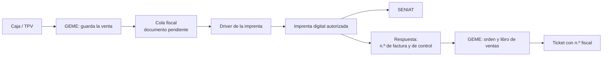
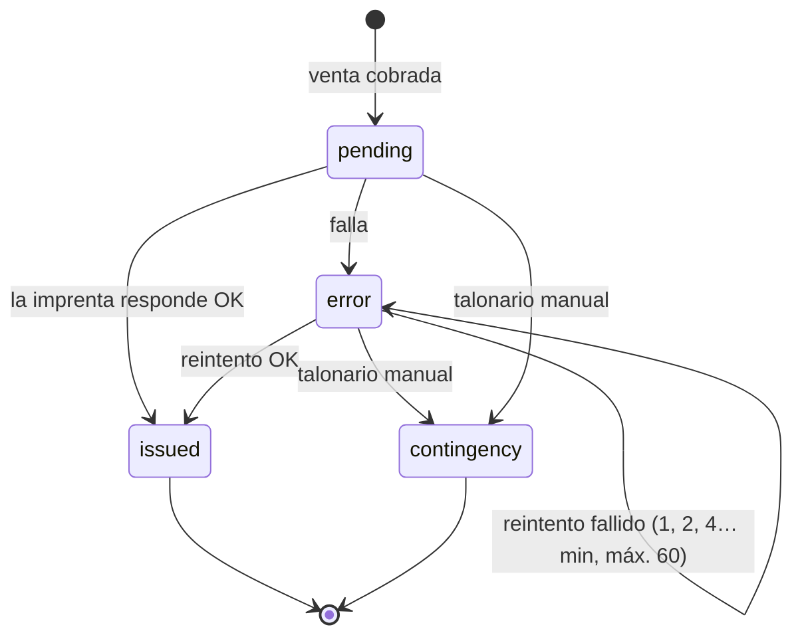

# GEME — Integración con imprenta digital autorizada (SNAT/2026/00093)

| | |
|---|---|
| **Fecha** | 22 de noviembre de 2026 |
| **Autor** | Thomas (con apoyo de Claude) |
| **Estado** | Base común implementada (commit `6cf6705`); falta el driver de la imprenta elegida |
| **Relacionado** | `GEME-analisis-competencia-IA-ISO27001-SENIAT.md` (sección 5) |

---

## 1. Objetivo y alcance

A partir del **19 de abril de 2027**, los comercios deben emitir sus facturas por un medio autorizado (portal del SENIAT, imprenta digital o proveedor tecnológico autorizado, o máquina fiscal). GEME no es en sí un medio autorizado, así que necesita **conectarse a uno**.

Esta documentación describe la **parte común ya construida**, que es independiente de la imprenta, y cómo añadir después el conector de la imprenta que se elija.

**Principios de diseño**
1. **Opcional y apagado por defecto.** Con el medio «Ninguno», GEME funciona exactamente como antes.
2. **La venta nunca se bloquea.** La emisión fiscal se hace después de guardar la venta; si falla, se reintenta o se resuelve por contingencia.
3. **Sin dependencia de una imprenta.** Cada imprenta es un *driver* que implementa una interfaz común.
4. **Trazabilidad.** Cambios de medio y registros de contingencia quedan en la auditoría.

**Fuera de alcance (de momento):** el driver de una imprenta real, notas de crédito/débito por el medio, la validación del dígito verificador del RIF y el puente local para máquinas fiscales (p. ej. HKA 80).

> **Aviso:** los requisitos legales proceden de resúmenes de asesoras y prensa, no del texto íntegro de la Gaceta Oficial 43.484. Un asesor tributario debe confirmarlos antes de poner nada en producción.

---

## 2. Quién elige la imprenta

- La obligación legal es del **comercio** (el cliente de GEME), no de GEME.
- Cada imprenta tiene su propia API; el cliente solo puede usar las que **GEME soporte**.
- Reparto previsto:

| Quién | Qué hace |
|---|---|
| **GEME** | Desarrolla los conectores (empezando por 1–2 imprentas con buena API). |
| **El cliente** | Contrata la imprenta entre las soportadas e introduce sus credenciales en Administración. |
| **Cliente sin conector** | Usa su máquina fiscal o el portal del SENIAT; GEME sigue llevando ventas y libros como hoy. |

Antes del 19-04-2027 debe haber **al menos un conector funcionando**.

---

## 3. Arquitectura



| Pieza | Archivo | Función |
|---|---|---|
| Interfaz | `app/Services/Fiscal/FiscalProvider.php` | Contrato que cumple cada imprenta (`key`, `issue`, `testConnection`). |
| Resultado | `app/Services/Fiscal/FiscalResult.php` | Éxito (n.º de factura, control, referencia) o fallo (mensaje, ¿reintentable?). |
| Selector | `app/Services/Fiscal/FiscalManager.php` | Elige el medio de la tienda (por defecto `none`) y registra los drivers. |
| Datos de la factura | `app/Services/Fiscal/FiscalPayloadBuilder.php` | Construye el contenido neutro de la factura. |
| Emisión y cola | `app/Services/Fiscal/FiscalEmissionService.php` | Encola, emite, reintenta y registra contingencia. |
| Trabajo | `app/Jobs/IssueFiscalDocument.php` | Se ejecuta tras responder al TPV (`dispatchAfterResponse`), sin worker. |
| Proveedor de pruebas | `app/Services/Fiscal/SandboxProvider.php` | Simula una imprenta con numeración «PRUEBA-…». |
| Formato RIF | `app/Services/Fiscal/RifValidator.php` | Valida el formato de RIF y cédula. |
| Pantallas | `FiscalDocumentController` + vistas `fiscal/index` y `settings/fiscal` | Ajuste de admin y bandeja de documentos. |

---

## 4. Ciclo de vida de un documento



| Estado | Significado |
|---|---|
| `pending` | Creado, a la espera de emitir. |
| `issued` | Emitido por el medio; tiene n.º de factura y de control. |
| `error` | Falló. Se reintenta con espera creciente hasta **8 intentos**; después requiere intervención. |
| `contingency` | Se registró a mano una factura de talonario (con su n.º y control). |
| `cancelled` | Anulado (reservado para notas de crédito). |

**Reglas**
- Hay **un documento por pedido y tipo** (restricción única): encolar dos veces no duplica.
- Un fallo **no reintentable** (datos rechazados) pasa a `error` sin fecha de reintento: requiere intervención.
- Los documentos resueltos (`issued`, `contingency`, `cancelled`) no se pueden volver a emitir ni a registrar.

---

## 5. Datos que se envían a la imprenta

`FiscalPayloadBuilder::build($order)` produce un arreglo neutro; cada driver lo traduce al formato de su imprenta.

| Campo | Contenido |
|---|---|
| `document_type` | `FACTURA` (notas de crédito/débito, pendientes) |
| `order_number`, `issued_at` | N.º interno y **fecha y hora** de emisión (ISO 8601) |
| `issuer` | RIF, razón social y domicilio fiscal (datos de empresa en Administración) |
| `buyer` | Nombre, RIF/cédula normalizado y si el formato es válido; «CONSUMIDOR FINAL» si no hay cliente |
| `items[]` | Descripción, cantidad, precio, alícuota, **marca `exempt` (E)**, base, IVA y total |
| `exempt_amount`, `tax_by_rate[]` | Monto exento y base e IVA **por alícuota** |
| `subtotal`, `tax_total`, `total` | Totales en USD |
| `currency`, `exchange_rate`, `total_bs` | Moneda, **tasa BCV de la venta** y equivalente en Bs |
| `affected_document_number` | Factura afectada (para notas) |

**Tasa por venta.** Cada venta guarda en `orders.exchange_rate` la tasa BCV vigente (con respaldo en el ajuste `bcv_rate`). El ticket muestra el equivalente en Bs y la tasa. Las ventas anteriores a esta versión no tienen tasa.

**Validación de RIF.** Solo el **formato** (`J-12345678-9`, `V-12345678`, `E-81234567`…), sin comprobar el dígito verificador ni consultar al SENIAT. Un RIF inválido no impide la venta; el campo `tax_id_valid` permite al driver decidir.

---

## 6. Base de datos

Migración `2026_11_24_000000_create_fiscal_documents_table`:

- Tabla **`fiscal_documents`**: `order_id`, `document_type`, `status`, `provider`, `environment` (`test`/`production`), `attempts`, `next_attempt_at`, `last_error`, `payload` (JSON), `invoice_number`, `control_number`, `provider_reference`, `exchange_rate`, `issued_at`, `resolved_by`. Índice único `(order_id, document_type)`.
- Columna **`orders.exchange_rate`** (decimal 18,6, nullable).

La migración no modifica datos existentes y se ejecuta sola en el despliegue (el Dockerfile lanza `migrate`).

**Libro de ventas.** Con un documento emitido o en contingencia, `FiscalLedgerService::recordSale` usa el **n.º de factura** (`orders.external_invoice_number`) y el **n.º de control del medio** en lugar del número interno.

---

## 7. Uso y operación

### 7.1 Configuración (Admin)
*Administración → Medio de emisión fiscal.* Opciones: **Ninguno** (por defecto) y **Proveedor de pruebas**. Cada cambio queda en la auditoría (`fiscal_provider_changed`).

> El proveedor de pruebas **no tiene validez fiscal**: sus números llevan el prefijo `PRUEBA-` y el ticket lo indica. No debe usarse para facturar de verdad.

### 7.2 Bandeja (Admin, Supervisor, Contable)
*menú del Libro Electrónico SENIAT → Facturación fiscal*: filtro por estado, **Reintentar** un documento, **Procesar pendientes** y **Talonario** (registrar n.º de factura y de control; auditoría `fiscal_contingency`).

### 7.3 Reintentos automáticos
Existe el comando:

```bash
php artisan fiscal:process-pending
```

Procesa los pendientes y los errores cuya espera ya venció (máx. 50 por ejecución). La primera emisión ocurre sola al vender (`dispatchAfterResponse`); **los reintentos automáticos requieren programar este comando** (p. ej. cada minuto en el cron del contenedor o del planificador de CapRover). Sin programarlo, se pueden lanzar con el botón de la bandeja.

### 7.4 Ticket
Muestra el equivalente en Bs con la tasa y, si hay documento, el n.º de factura y de control (o «pendiente de emisión»). Con entorno de pruebas añade «DOCUMENTO DE PRUEBA · SIN VALIDEZ FISCAL».

---

## 8. Cómo añadir una imprenta (guía de desarrollo)

1. **Crear el driver** en `app/Services/Fiscal/`, implementando `FiscalProvider`:

```php
class MiImprentaProvider implements FiscalProvider
{
    public function key(): string { return 'mi_imprenta'; }

    public function issue(array $payload): FiscalResult
    {
        // 1. Traducir $payload al formato de la API de la imprenta
        // 2. Llamar a su API (HTTPS, con timeout)
        // 3. Éxito:  return FiscalResult::success($numeroFactura, $numeroControl, $referencia);
        //    Error de red/5xx:  return FiscalResult::failure('mensaje', true);   // se reintenta
        //    Rechazo por datos: return FiscalResult::failure('mensaje', false);  // intervención
    }

    public function testConnection(): FiscalResult { /* validar credenciales sin emitir */ }
}
```

2. **Registrarlo** en `FiscalManager`: añadir `'mi_imprenta' => MiImprentaProvider::class` a `PROVIDERS` y su etiqueta a `LABELS`.
3. **Credenciales:** guardarlas **cifradas** (como la clave de IA, con `Crypt` y la `APP_KEY`), nunca en el repositorio ni en los registros, y mostrar solo los últimos caracteres. Añadir un selector de entorno de **pruebas / producción**.
4. **Seguridad de red:** solo `https://`; no seguir redirecciones a redes internas (reutilizar la idea de `AiUrlGuard`).
5. **Idempotencia:** enviar un identificador estable (`order_number` o el `id` del documento) para que un reintento no genere una factura duplicada en la imprenta. Antes de reintentar tras un *timeout*, **consultar si la imprenta ya emitió** el documento.
6. **Pruebas:** tests con la API simulada (`Http::fake`) y una batería en el entorno de pruebas de la imprenta antes de producción.

---

## 9. Seguridad y cumplimiento (ISO 27001)

| Aspecto | Medida |
|---|---|
| Datos personales | Solo viaja lo necesario para la factura (adquirente con RIF/cédula, como exige la norma). |
| Credenciales (5.17, 8.24) | Cifradas con `APP_KEY`; rotación periódica; nunca en el repositorio. |
| Proveedores (5.19–5.23) | Dar de alta la imprenta en el registro de proveedores del SGSI, con contrato y condiciones de tratamiento de datos. |
| Trazabilidad (8.15) | Auditoría de cambio de medio y de contingencias; cada documento guarda intentos, error y quién lo resolvió. |
| Continuidad (5.30) | La venta no depende de la imprenta; contingencia con talonario. |
| Integridad | Se mantiene la cadena de integridad del libro (`FiscalIntegrityService`). |

---

## 10. Pruebas

`tests/Feature/FiscalEmissionTest.php` (11 pruebas) cubre: comportamiento por defecto sin medio y tasa guardada en la venta; emisión con el proveedor de pruebas y su reflejo en orden y libro; no duplicados; fallo, reintento y tope de intentos; contingencia con auditoría; datos de la factura (exentos, alícuotas, RIF, Bs); formato de RIF; permisos (el vendedor no accede, el contable ve la bandeja pero no los ajustes); ticket.

Suite completa tras este cambio: **115 pruebas correctas**.

---

## 11. Pendiente y hoja de ruta

| Tarea | Dependencia |
|---|---|
| Elegir imprenta digital y verificar su autorización ante el SENIAT | Asesor tributario |
| Driver de la imprenta con credenciales cifradas y entorno pruebas/producción | Documentación de su API y entorno de pruebas |
| Notas de crédito y débito por el medio | Driver |
| Envío del PDF al día siguiente tras una contingencia | Requisito de la norma (según resúmenes) |
| Programar `fiscal:process-pending` | CapRover |
| Dígito verificador del RIF | — |
| Puente local para máquinas fiscales (p. ej. HKA 80) | Cliente con máquina; manual de protocolo del fabricante |
| Comunicar el cambio de medio al SENIAT (si procede) | Asesor tributario |

**Calendario (hasta el 19-04-2027):** selección de imprenta y validación tributaria (dic. 2026) → driver (ene.–feb. 2027) → pruebas y piloto en `tienda.quorixtech.eu` (mar. 2027) → producción (antes del 19-04-2027).

### Criterios para elegir imprenta
- Autorización vigente verificable ante el SENIAT.
- API documentada, con **entorno de pruebas** y autenticación por clave/token.
- Número de control y de factura devueltos en la respuesta; soporte de notas de crédito/débito.
- Consulta del estado de un documento (para reintentos sin duplicar).
- Condiciones de datos (retención, ubicación, sin uso para otros fines), disponibilidad y coste por documento.
